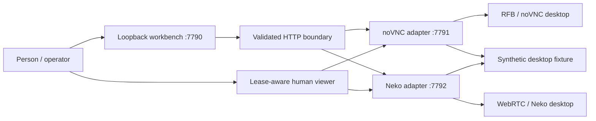

# Sidekicks computer-use lab

The implemented harness is a small Go HTTP workbench with a TypeScript adapter contract. It has no model API integration. Named bots post intents to an in-memory shared thread, and a person explicitly dispatches inputs through a computer adapter. Terminal and browser interfaces are contracts for future implementations.

## Boundaries

- **Workbench:** fixed backend allowlist, same-origin browser requests, ephemeral bearer for mutations, 64 KiB input bound, explicit normalized input validation, bounded image decoding, adapter conflict preservation. It never executes shell commands.
- **Computer adapters:** authoritative ownership and held-input release. A central UI pause label would not arbitrate a raw browser/WebRTC/RFB input path. The gate belongs at each adapter's final input dispatch point.
- **Human viewer:** distinct streaming and input route. A valid screenshot endpoint does not establish a working decoded live stream. Native browser events sent to a remote display need their own verification.
- **Screenshot:** PNG/JPEG, requested maximum 1280 × 720 by default, hard cap 1920 × 1080 and 4 MiB. The workbench decodes image metadata and rejects a backend exceeding the requested bounds. Coordinates refer to original desktop pixels; scaled image coordinates require multiplying by source / image dimensions.
- **Fixture:** synthetic text and interactions only. Event timestamps include wall clock for artifacts and performance.now() for local intervals. Native gesture observations are distinguished from Ctrl+wheel translation. No model inference is implied by image capture.
- **Terminal:** future argv-based operation must require a disposable environment ID. No arbitrary host shell endpoint exists.
- **Browser:** future contexts are task-owned and isolated from the person's browsing state.

## Safe ownership lifecycle

Adapters enforce expiring leases (default 30 s, maximum 60 s). Human acquisition invalidates agent tokens and queued actions and releases held keys/buttons. Agent acquisition cannot displace a human. Every batch rechecks owner, session, token, and expiry. Disconnect, blur, stop, or expiry releases held inputs. The workbench only offers the operator an interface to these requirements; independent QA verifies actual enforcement in each POC.

The workbench viewer launcher acquires a human lease before opening `viewerUrl` with token/session parameters. noVNC's viewer consumes and removes those parameters. Adapter-specific behavior remains documented in each POC README. Tokens are ephemeral local demo control state and are not production authentication.

## Evidence vocabulary

**PASS / tested** requires an executed end-to-end test and linked evidence. **FAIL** records an executed failing check. **UNTESTED** means no adequate execution evidence yet. **EMULATED** describes a translation such as Ctrl+wheel zoom, or an emulated CPU platform, and does not imply native hardware support. **Implemented** describes code paths awaiting independent proof.

Cross-stack latency comparisons require the same resolution, workload, resources and clock/sampling method, with sequential runs and at least 30 samples. HTTP screenshot duration, ping and signaling RTT must not be labeled human action-to-decoded-frame latency. Physical Mac pinch/swipe and subjective audio listening remain untested unless a person performs them.

## Generic desktop takeover and application backlog

Normal takeover must remain usable in arbitrary native windows. It enforces an injection cutoff, cancellation of future commands, stale-token rejection and release of held inputs. Applications can still process previously injected events; ownership-ready does not mean every application queue has been flushed. Small paced batches and a documented settling interval reduce backlog without establishing generic rollback. Any fixture-specific delivery fence is optional diagnostic instrumentation and cannot gate the normal terminal/browser/native-app path.
