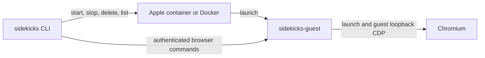
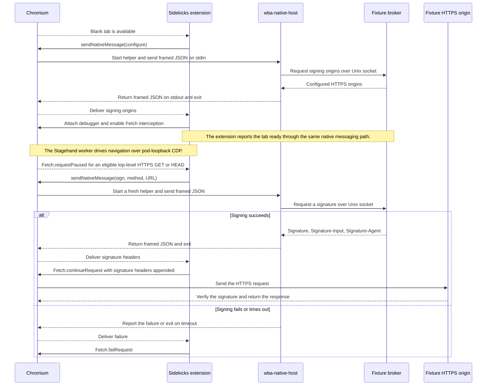

# Browser-use image

The browser payload uses Debian 13 slim and Chromium in unified headless
mode. It runs as UID/GID 2000 with a private profile. The image ships the
Stagehand extension embedded in the pinned Go SDK, the compiled Sidekicks
extension, and the Go native messaging helper. The Dockerfile builds these
artifacts in separate stages.

## Run a local browser

- For Apple `container` on Apple silicon with macOS 26 or later, install
  `container` and run `container system start` and `make browser-image-apple`.
  Sidekicks was tested with `container` 1.7.1. Run
  `export SIDEKICKS_RUNTIME=apple` in the shell you use for the example below.
- For Docker on macOS or Linux, start Docker and run `make browser-image-docker`.
  Run `export SIDEKICKS_RUNTIME=docker` in the shell you use for the example below.

```sh
make sidekicks
build/sidekicks browser start --name web
build/sidekicks browser cmd --name web goto https://example.com
build/sidekicks browser cmd --name web snapshot
build/sidekicks browser screenshot --name web -o page.png
build/sidekicks browser stop --name web
build/sidekicks browser delete --name web
```

macOS defaults to `apple`. Linux uses `docker`. Run `build/sidekicks config
set runtime docker` to set the default on macOS, or pass `--runtime docker`
for a single command. The Docker backend uses the active local Unix-socket
context. `config show` reports the effective setting and its source. `list`
shows running and stopped browsers in the selected runtime.

For a custom image tag, pass `BROWSER_IMAGE=<tag>` to `make browser-image-apple`,
`make browser-image-docker`, and `make cli-integration`. Set
`SIDEKICKS_BROWSER_IMAGE=<tag>` when invoking `sidekicks` directly.

The Docker adapter launches the browser container with `seccomp=unconfined`
so Chromium can start its own namespace sandbox. This disables Docker's outer
syscall filter for both Chromium and `sidekicks-guest` in the container.
Before broader deployment, validate a profile derived from Docker's default
on Linux and Docker Desktop that permits Chromium's sandbox setup.

`browser tabs` lists live tab IDs. Browser commands and screenshots default
to the primary tab and accept `--tab <id>` to target another tab. `browser cmd
click` takes a selector. `browser cmd type` takes a selector and the replacement
text. Both accept CSS selectors and XPath selectors with an `xpath=` prefix.
`browser cdp` takes a method and an optional JSON object as a second argument.
Methods in the `Browser`, `Target`, and `SystemInfo` domains default to browser
scope. Pass `--browser` to select browser scope explicitly.

If Stagehand reports that its CDP connection closed, stop and start the
named browser to recover typed commands. The pinned Stagehand worker can
retain the disconnected session. A stop and start preserves the browser profile.

The integration test uses a temporary config directory. Run
`make cli-integration` for the platform default or set `SIDEKICKS_RUNTIME`
explicitly, for example `SIDEKICKS_RUNTIME=docker make cli-integration` on
macOS. After building the image into both runtimes, run
`SIDEKICKS_TEST_BOTH=1 make cli-integration` on macOS to exercise both
lifecycles and verify that their instance names are independent.
[CLI design](../../../docs/sidekicks-cli.md)

## Local Kubernetes development

Enable Kubernetes in Docker Desktop and run from the repository root.

```sh
make dev
```

This builds the browser and dev-tools images, makes the images available to
the Docker Desktop Kubernetes nodes, applies the `sidekicks-dev` deployment,
and waits for readiness. The dev images use `:latest`, and applying again
restarts the existing Deployment so the pod uses the newly loaded images.
The command then runs the localhost port-forward in the
foreground. The gateway listens locally on port 18080 and the WBA observer
on port 18081. Override `DEV_GATEWAY_PORT` and `DEV_FIXTURE_PORT` in both
terminals to use different local ports. The in-pod ports, broker mount, and
fixture settings come from `infrastructure/kubernetes/dev/browser.env`.

From a second terminal, run the repository's integration suite.

```sh
make integration
```

The browser tests connect to the deployed stack using a token generated
under `build/dev/`. They create and close their own tabs. The repo-wide
suite also runs the existing live Web Bot Auth checks, which require
`http-signature-directory` and access to the SSH tunnel and external
verifiers.

For a browser-only run or for CI, point the tests at an existing deployment
with `BROWSER_GATEWAY_URL`, `WBA_FIXTURE_URL`, and
`BROWSER_GATEWAY_TOKEN`. Set `BROWSER_CDP_ADDRESS` to the expected guest
loopback address from that deployment.

```sh
BROWSER_GATEWAY_URL=http://127.0.0.1:18080 \
WBA_FIXTURE_URL=http://127.0.0.1:18081 \
BROWSER_CDP_ADDRESS=127.0.0.1:9222 \
BROWSER_GATEWAY_TOKEN="$(cat build/dev/gateway-token)" \
go test -v -count=1 -tags=integration ./infrastructure/images/browser-use
```

Use `make container-build`, `make kubernetes-apply`, and
`make kubernetes-forward` to run the individual steps. To shut down the
stack, stop the foreground port-forward and run `make kubernetes-down`.
This deletes the `sidekicks-dev` namespace from the Docker Desktop context.

## Browser control and signing

`sidekicks-guest` launches Chromium and serves the authenticated browser API,
including discovery and browser WebSocket connections. Chromium's raw CDP
listener stays on guest loopback. The embedded Stagehand worker uses that
listener directly. The guest acquires its Stagehand session on the first typed
browser command.



Apple publishes a Unix socket inside a private host directory. Docker publishes
the guest port on host loopback. The Kubernetes dev stack port-forwards the
guest port from the browser container.

The Sidekicks extension starts the Go native messaging helper through
`com.sidekicks.wba.json`. The helper sends a JSON message to
`/run/sidekicks/wba/broker.sock` and times out after one second. In the dev
deployment the fixture sidecar owns this socket and the ephemeral signing key.
The fixture also serves three HTTPS test origins and reports observations for
each test run. Chromium accepts the fixture's HTTPS certificate using its
pinned TLS public key.

### Web Bot Auth request sequence



The extension evaluates each redirect hop independently. It keeps retrying
broker configuration while the tab is still blank. An attached tab renews its
readiness lease every four seconds. The fixture expires readiness after
twelve seconds without renewal. Closing a prepared tab or losing its
debugger attachment retires it immediately once the fixture receives the
notification. The fixture retains that retirement for twelve seconds and
rejects readiness messages older than twelve seconds. Use a fresh blank tab
for signed navigation after a detach.

The Kubernetes dev browser runs with a read-only root filesystem and dropped
capabilities. The browser container overrides the pod's `RuntimeDefault`
seccomp profile with `Unconfined`. This disables the outer syscall filter
so Chromium can start its own user-namespace sandbox. Validate a restrictive
profile on the target Kata runtime. Keep the production signing broker and
signing credentials outside the browser workload. Force-install the production
extension under a stable ID.

## Base image and maintenance

Debian's packaged Chromium includes the runtime libraries and browser data;
APT owns the dependency inventory. Rebuild regularly with a fresh base and
package install (`--pull --no-cache`), record the Chromium version, generate
and scan an SBOM, and deploy the tested image by digest. Dependabot tracks the
base images declared in the Dockerfile. A digest pin on the base alone does
not freeze APT's package versions.
