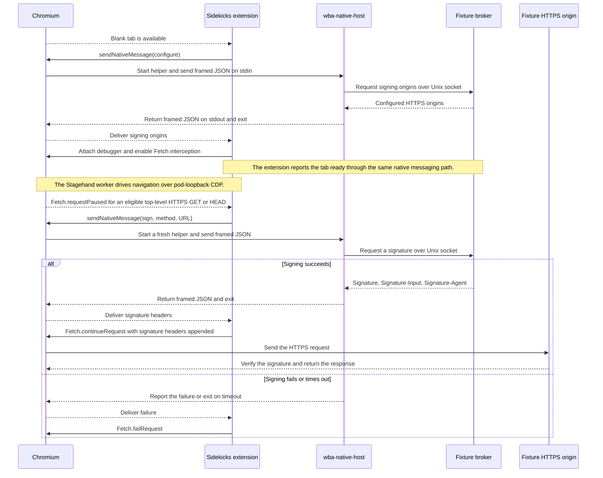

# Browser-use image

The browser payload uses Debian 13 slim and Chromium in unified headless
mode. It runs as UID/GID 2000 with a private profile. The image ships the
Stagehand extension embedded in the pinned Go SDK, the compiled Sidekicks
extension, and the Go native messaging helper. The Dockerfile builds these
artifacts in separate stages.

## Local Kubernetes development

Enable Kubernetes in Docker Desktop and run from the repository root.

```sh
make dev
```

This builds the browser and dev-tools images, makes the images available to
the Docker Desktop Kubernetes nodes, applies the `sidekicks-dev` deployment,
and waits for readiness. The dev images use `:latest`, and applying again
restarts the existing Deployment so the pod uses the newly loaded images.
The command then runs the localhost port-forward in the
foreground. The gateway listens locally on port 18080 and the WBA observer
on port 18081. Override `DEV_GATEWAY_PORT` and `DEV_FIXTURE_PORT` in both
terminals to use different local ports.

From a second terminal, run the repository's integration suite.

```sh
make integration
```

The browser tests connect to the deployed stack using a token generated
under `build/dev/`. They create and close their own tabs. The repo-wide
suite also runs the existing live Web Bot Auth checks, which require
`http-signature-directory` and access to the SSH tunnel and external
verifiers.

For a browser-only run or for CI, point the tests at an existing deployment
with `BROWSER_GATEWAY_URL`, `WBA_FIXTURE_URL`, and
`BROWSER_GATEWAY_TOKEN`.

```sh
BROWSER_GATEWAY_URL=http://127.0.0.1:18080 \
WBA_FIXTURE_URL=http://127.0.0.1:18081 \
BROWSER_GATEWAY_TOKEN="$(cat build/dev/gateway-token)" \
go test -v -count=1 -tags=integration ./infrastructure/images/browser-use
```

Use `make container-build`, `make kubernetes-apply`, and
`make kubernetes-forward` to run the individual steps. To shut down the
stack, stop the foreground port-forward and run `make kubernetes-down`.
This deletes the `sidekicks-dev` namespace from the Docker Desktop context.

## Browser control and signing

The gateway sidecar exposes authenticated Chromium discovery and browser
WebSocket connections. Chromium's raw CDP listener stays on pod loopback.
The host SDK connects through the gateway, and the Stagehand worker connects
directly to guest loopback.

The Sidekicks extension starts the Go native messaging helper through
`com.sidekicks.wba.json`. The helper sends a JSON message to
`/run/sidekicks/wba/broker.sock` and times out after one second. In the dev
deployment the fixture sidecar owns this socket and the ephemeral signing key.
The fixture also serves three HTTPS test origins and reports observations for
each test run. Chromium accepts the fixture's HTTPS certificate using its
pinned TLS public key.

### Web Bot Auth request sequence



The extension evaluates each redirect hop independently. It keeps retrying
broker configuration while the tab is still blank. An attached tab renews its
readiness lease every four seconds. The fixture expires readiness after
twelve seconds without renewal. Closing a prepared tab or losing its
debugger attachment retires it immediately once the fixture receives the
notification. The fixture retains that retirement for twelve seconds and
rejects readiness messages older than twelve seconds. Use a fresh blank tab
for signed navigation after a detach.

The browser runs with a read-only root filesystem and dropped capabilities.
The local Kubernetes manifest uses an unconfined outer seccomp profile for
Chromium so its own user-namespace sandbox can start. Validate the deployment
profile on the target Kata runtime. The production supervisor, browser
gateway, Signing Broker, and signing credentials belong outside the browser
workload. The production extension should be force-installed under a stable ID.

## Base image and maintenance

Debian's packaged Chromium includes the runtime libraries and browser data;
APT owns the dependency inventory. Rebuild regularly with a fresh base and
package install (`--pull --no-cache`), record the Chromium version, generate
and scan an SBOM, and deploy the tested image by digest. CI can override
`DEBIAN_IMAGE` with an approved Debian base digest. A digest pin on the base
alone does not freeze APT's package versions.
